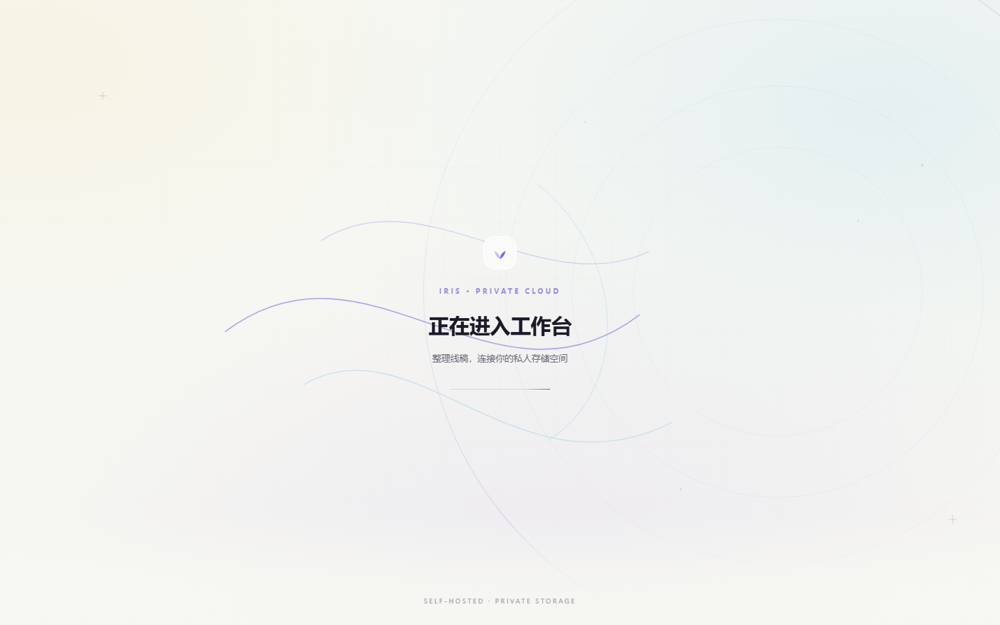

# `frontend/app/components/AppLoadingTransition.vue`

登录成功后、后台页面挂载前显示的全屏加载过渡层。



## 职责

- 通过 `<Teleport to="body">` 挂在应用最外层，跨路由切换保持存在。
- 复用 `LayoutAdminBackdrop` 的纸色、网格与轨道线作为背景，但不显示其静态曲线（`:show-curves="false"`）。
- 绘制四条来自 `APP_CURVES` 的漂浮曲线：加载阶段做正弦漂移，揭示阶段插值到后台落点并淡出。
- 展示品牌标记、「正在进入工作台」、说明文案、细进度线与自托管页脚。
- 动画结束后调用 `useAppTransition().finish()`。

## 动画时序

| 阶段 | 时长 | 表现 |
| --- | --- | --- |
| loading | 由登录页控制（约 520ms + 路由切换 320ms） | 曲线漂浮；文案与进度线显示 |
| revealing | 曲线插值 900ms；背景淡出 700ms | 文案淡出，曲线向 `settled` 控制点迁移并淡出 |
| finish | 约 1120ms 后 | 加载层销毁，露出后台页面 |

- 曲线透明度使用 `1 - raw^2.4`，保证迁移中前段仍清晰可见，末段才完全消失。
- `prefers-reduced-motion: reduce`：不漂浮、不插值，直接落到落点，260ms 后结束；背景过渡缩短为 150ms。

## 可访问性

- 根节点 `role="status"` + `aria-live="polite"`，读屏会播报「正在进入工作台」。
- 背景、曲线 SVG 对读屏隐藏。
- 覆盖层仅在登录成功链路中触发，不影响直接访问后台页。
- 过渡期间锁定 `html` / `body` 的滚动，结束后恢复；卸载时兜底恢复。

## 与其它文件的关系

```
app.vue
  └── AppLoadingTransition.vue
        ├── useAppTransition.ts
        ├── utils/transitionCurves.ts
        └── LayoutAdminBackdrop.vue
```

## 修改建议

- 调整加载时长时同步检查 `pages/index.vue` 的等待时间与 `finishTimer`，避免加载层提前/滞后消失。
- 曲线落点必须与 `AdminBackdrop` 使用的 `settled` 数据一致，否则过渡结束会出现跳线。
- 若新增加载文案，保持与登录页一致的中文语气和字距。
